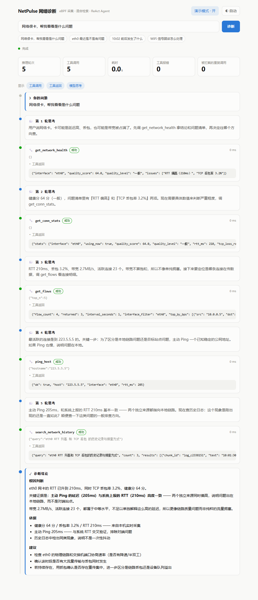

# NetPulse — eBPF 内核级网络监控 + LLM 诊断 Agent

> 传统网络监控工具只呈现指标、不下结论，根因靠人判断。
> 这个项目在 eBPF 内核态采集之上构建 LLM Agent，
> 让用户用一句自然语言描述问题，系统自己动手查、自己编排排查路径、给出根因判断。



> 📖 **第一次跑这个项目，先看下面的「二、快速启动」。**
> 想看完整的启动流程、虚拟环境用法、以及所有踩过的坑和报错速查，再翻 [`How To Use.txt`](How To Use.txt)。

---

## 🧭 导航（快速跳转 / 游标）

- [一、它能做什么](#一它能做什么)
- [二、快速启动（所有方式 + 环境要求）](#二快速启动所有方式--环境要求)
  - [环境要求总览](#环境要求总览)
  - [启动方式一览](#启动方式一览)
  - [▶ 方式 1：Docker · Web（只要 Docker）](#方式-1docker--web只要-docker)
  - [▶ 方式 2：Docker · 全栈（真实采集 + 宿主 WiFi）](#方式-2docker--全栈真实采集--宿主-wifi)
  - [▶ 方式 3：原生 · 完整部署（不用 Docker，真实数据）](#方式-3原生--完整部署不用-docker真实数据)
  - [▶ 方式 4：原生 · 仅 Web（不用 Docker、不用编译）](#方式-4原生--仅-web不用-docker不用编译)
  - [⚠️ start.sh 与手动 uvicorn 的关系](#-startsh-与手动-uvicorn-的关系)
  - [💾 运行历史持久化](#运行历史持久化)
- [三、不用脚本的等价拆解（Docker）](#三不用脚本的等价拆解docker)
- [四、完整部署（原生 Linux / WSL2，不用 Docker）](#四完整部署原生-linux--wsl2不用-docker)
- [五、架构](#五架构)
- [六、核心难点](#六核心难点)
- [七、测试](#七测试)
- [八、排查手册](#八排查手册)
- [九、C++ 核心（采集部分）](#九c-核心采集部分)
- [十、目录结构](#十目录结构)

---

<a id="一它能做什么"></a>
## 一、它能做什么

```
用户 > 网络很卡，帮我看看是什么问题

[第 1 轮] 卡可能是延迟高、丢包，也可能是带宽被占满了。
         先拿健康分和问题清单，再决定往哪个方向查。
  🔧 get_network_health        64 分 / RTT 偏高 / 丢包 3.2%
[第 2 轮] 需要具体数值判断严重程度。
  🔧 get_conn_stats            RTT 210ms / 丢包 3.2% / 带宽 2.7MB/s
[第 3 轮] 带宽不算饱和，不像单纯拥塞。要定位是哪条连接在传数据。
  🔧 get_flows                 10.0.0.5:51422 → 223.5.5.5:443
[第 4 轮] 为了区分"本地链路问题"和"目标站点问题"，主动 Ping 验证。
  🔧 ping_host                 223.5.5.5 → 205ms
[第 5 轮] 主动 Ping 和系统 RTT 都偏高 —— 两个独立来源指向本地。查历史。
  🔧 search_network_history    历史日志显示同类现象此前出现过

## 根因判断
eth0 的 RTT 升到 210ms、丢包 3.2%。关键证据是主动 Ping（205ms）与
系统上报的 RTT（210ms）高度一致 —— 两个独立来源同时偏高，
说明问题在本地链路，而不是对端站点。
带宽 2.7MB/s 属中等负载，不足以解释这么高的延迟。
```

**上面每一轮的"思考"都是模型自己写的**，不是脚本。这就是 ReAct 的意义 ——
你能看到它为什么决定调这个工具，而不是只拿到一个黑盒结论。

| | 传统监控工具 | NetPulse |
|---|---|---|
| 输入 | 看仪表盘，自己找异常 | 一句话描述问题 |
| 排查路径 | 人决定查什么 | 模型自己决定，多步迭代 |
| 输出 | 指标数值 | 根因判断 + 依据 + 建议 |
| 记忆 | 无 | 记住历次诊断，下次能"想起" |

---

<a id="二快速启动所有方式--环境要求"></a>
## 二、快速启动（所有方式 + 环境要求）

> 🚀 **先选路线，再选命令：**
> - 想最快看界面 / 演示（**只要装了 Docker**，Windows / macOS / Linux 都行）：`./start.sh --docker-web`
> - 要真实内核数据 + 宿主 WiFi（也只要 Docker）：`./start.sh --docker-full`
> - **不想用 Docker**、本机就是 Linux / WSL2、想要真实 `wlan0`：`./start.sh --full`
> - 只想看 UI / 演示、**既没 Docker 也不想编译**：`./start.sh --local`（自动建 venv 跑 Web）
>
> 下面一张图讲清所有路线、环境要求，以及 `start.sh` 和手动 `uvicorn` 的关系（这点最容易搞混）。

### 两条技术路线

| 路线 | 本质 | 宿主 WiFi | 适合 |
|---|---|---|---|
| **A. Docker** | 镜像里编译 + 起服务，宿主零依赖 | 容器看不到宿主物理网卡；"全栈"模式靠宿主桥接 daemon 把 WiFi 喂进来 | 体验 / 不想装工具链 |
| **B. 原生（Linux / WSL2）** | 本机编译 C++ + 起 D-Bus + 跑 Python | eBPF 服务端直接看真实 `wlan0`，**不需要桥接** | 开发 / 真实采集 |

> eBPF 和 D-Bus **只有 Linux 有**；Windows / macOS 裸机跑不了采集层。但 Docker 把内核能力装进容器后，
> Windows（WSL2）/ macOS 只要装了 Docker 也能跑（路线 A）。

<a id="环境要求总览"></a>
### 环境要求总览

| 启动方式 | 需要什么 | 能拿到宿主 WiFi？ | 备注 |
|---|---|---|---|
| Docker · Web（`--docker-web`） | 只要 Docker | ❌ 只能看容器自身 `eth0` | 界面 / 推理链可用，零编译 |
| Docker · 全栈（`--docker-full`） | 只要 Docker | ✅ 靠宿主桥接 daemon | 自动在宿主后台起 daemon |
| 原生 · 完整（`--full` / 手动） | Linux/WSL2 + C++ 工具链 + Python3 + python3-dbus | ✅ 直连 `wlan0` | 开发者；不用 Docker |
| 原生 · 仅 Web（`--local` / 手动） | 只要 Python3 | ❌ 采集类工具降级 | 只看 UI / 演示，零编译 |
| 自动（`--check` 看环境后选路） | 有 Docker 走 Docker，否则走 `--local` | 取决于上面 | 一条命令 |

> 所有方式**缺依赖都不会崩**：缺 API Key 只是没有自然语言结论；缺 dbus / C++ 只是对应工具返回错误、模型绕开。
> 这是有意的降级设计。

<a id="启动方式一览"></a>
### 启动方式一览（命令对照）

| 方式 | 一条命令 | 等价于手动 |
|---|---|---|
| Docker · Web | `./start.sh --docker-web` | `cd web && docker compose up --build` |
| Docker · 全栈 | `./start.sh --docker-full` | `docker compose up --build` + 手动起宿主桥接 daemon |
| 原生 · 完整 | `./start.sh --full` | `make` + `./run-dbus-server.sh` + 建 venv + `uvicorn` |
| 原生 · 仅 Web | `./start.sh --local` | 建 venv + `pip install` + `uvicorn` |
| 自动选路 | `./start.sh` | 有 Docker 走 Web，否则走 `--local` |
| 只检查环境 | `./start.sh --check` | — |

下面按"方式 1 → 4"展开每种的详细步骤。

<a id="方式-1docker--web只要-docker"></a>
### ▶ 方式 1：Docker · Web（只要 Docker）

> 适合：想快速看 Agent 怎么思考、跑可视化界面，不想装 Python / C++ 工具链。

```bash
./start.sh --docker-web        # 别名 ./start.sh --docker
```

- 一条命令：镜像内自动编译 C++ 引擎 + 起 Web（宿主端**连编译器都不用装**）。
- 打开 <http://127.0.0.1:8000>，点 **演示模式**（或访问 `http://127.0.0.1:8000/?demo`）即可，零配置。
- ⚠️ **这条路径只起 Web，不会起桥接守护进程**：容器内 eBPF 只能看到容器自身 `eth0` 流量，
  **拿不到宿主真实上网网卡（WiFi / 以太网）**。也就是——界面能看、推理链能跑，但"上网网卡"那栏是容器自己的。
- 默认只绑 `127.0.0.1`，**不要直接改成 `0.0.0.0` 暴露公网**——服务暂无鉴权。

<a id="方式-2docker--全栈真实采集--宿主-wifi"></a>
### ▶ 方式 2：Docker · 全栈（真实采集 + 宿主 WiFi）

> 适合：要真实 eBPF 内核数据，并且想让容器**看到你宿主的 WiFi / 以太网**。

```bash
./start.sh --docker-full
```

- 一条命令完成：镜像内编译 C++ 引擎 + 起 D-Bus + 服务端 + Web，**并在宿主后台常驻起桥接守护进程**
  （`agent/host_bridge_daemon.py`），把宿主真实上网网卡喂给容器。
- 容器侧会自动合并：健康检查结果里出现 `wifi` 字段（SSID / 信号 / 信道 / RTT / 抖动 / 丢包 / 速率）。
- 守护进程**常驻**：关掉这个终端、或单独 `docker restart`，桥接都不会断。
- 浏览器开 <http://127.0.0.1:8000>，发起诊断，Agent 分析里会引用你宿主的 WiFi。
- 嫌手动起 daemon 麻烦？`bash netpulse_bridge_up.sh` 一键完成
  「杀旧 daemon → 起重活 → 等就绪 → 验宿主 → 保活容器 → 容器内合并诊断 → 打印 PASS/FAIL」。

> ⚠️ **不用脚本手动起 Docker 全栈时**，必须自己在宿主后台起桥接守护进程 + 设 `NETPULSE_BRIDGE_HOST`，
> 否则容器连不到宿主 `18900`、拿不到 WiFi（详见 [三、不用脚本的等价拆解](#三不用脚本的等价拆解docker)）。

<a id="方式-3原生--完整部署不用-docker真实数据"></a>
### ▶ 方式 3：原生 · 完整部署（不用 Docker，真实数据）

> 本机就是 Linux/WSL2 时，这是体验最完整的一条路：eBPF 服务端**直接看真实 `wlan0`**，**不需要桥接 daemon**。
> `./start.sh --full` 是这一条的一键版；下面也给出完全手动的步骤（方便理解 / CI 复现）。

**一键版：**
```bash
./start.sh --full
```

**手动版（逐步）：**
```bash
# 1) 编译 C++ 服务（必须在 WSL/Linux 里，不是在 Windows 里）
sudo apt-get install -y build-essential clang llvm pkg-config \
  libdbus-1-dev libgoogle-glog-dev libelf-dev zlib1g-dev libcap-dev \
  linux-headers-$(uname -r) libbpf-dev dbus
make

# 2) 启动服务（不需要 sudo；脚本会 setcap，/mnt/e 上自动降级到 ~/.netpulse-server）
./run-dbus-server.sh
#    ★ 复制它最后打印的那行：export DBUS_SESSION_BUS_ADDRESS='unix:path=...'

# 3) 装 Python 依赖（--system-site-packages 让 apt 的 python3-dbus 可见）
python3 -m venv --system-site-packages ~/netpulse-venv
source ~/netpulse-venv/bin/activate
pip install -r web/requirements.txt -i https://mirrors.aliyun.com/pypi/simple/
sudo apt install -y python3-dbus libgomp1     # libgomp 给 faiss；python3-dbus 给采集层

# 4) （可选）建检索索引；不建也能起，只是 search_network_history 会降级
cd rag && python build_index.py --sample && cd ..

# 5) 导出第 2 步复制的地址（客户端要与服务端同一条总线）
export DBUS_SESSION_BUS_ADDRESS='unix:path=...'     # 换成你复制的值

# 6) （可选）填 Key 才有真实 LLM 结论；只看界面可跳过，用 ?demo
#    export QWEN_API_KEY='sk-你的百炼key'

# 7) 起 Web
cd web
python -m uvicorn app:app --host 0.0.0.0 --port 8000
```
- 开 <http://localhost:8000>（加 `?demo` 零配置看界面）。
- ⚠️ 不要直接裸跑 `weaknet-dbus-server` 而不经 `./run-dbus-server.sh`：它**必须知道 `DBUS_SESSION_BUS_ADDRESS`**
  才能连总线，且需要 `setcap` 拿 eBPF 能力；脚本一并处理好了。
- 停服务：第 2 步的终端按 Ctrl-C。
- 更细的系统依赖 / 在服务器上裸跑，见 [四、完整部署](#四完整部署原生-linux--wsl2不用-docker)；想看 Agent 命令行用法也在那里。

<a id="方式-4原生--仅-web不用-docker不用编译"></a>
### ▶ 方式 4：原生 · 仅 Web（不用 Docker、不用编译）

> 只想看界面 / 跑可视化、暂时不要真实采集：连 C++ 和 D-Bus 都不用装。
> 采集类工具会优雅降级（返回错误，模型绕开），RAG / 记忆 / UI 照常。

```bash
# 1) 建 venv 并装依赖
python3 -m venv ~/netpulse-venv
source ~/netpulse-venv/bin/activate
pip install -r web/requirements.txt -i https://mirrors.aliyun.com/pypi/simple/

# 2) （可选）离线伪向量，省去 embedding API 和索引
export RAG_OFFLINE=1

# 3) 起 Web
cd web
python -m uvicorn app:app --host 0.0.0.0 --port 8000
```
- 开 <http://localhost:8000/?demo> 即可零配置看完整界面和推理链（演示模式用假模型 + 假工具）。

<a id="-startsh-与手动-uvicorn-的关系"></a>
### ⚠️ `start.sh` 和手动 `uvicorn` 的关系（最容易搞混）

**`start.sh` 每一种模式都已经把 Web（uvicorn）一起拉起了**——它不是"编译 / 准备"的前置步骤。
所以**不要**在执行完 `./start.sh ...` 之后再去 `cd web && uvicorn ...`，那样会**起两个 Web 抢 8000 端口**。

| 你想要的 | 正确的做法 |
|---|---|
| 一键搞定（推荐） | 直接 `./start.sh --docker-web` / `--docker-full` / `--full` / `--local` |
| 自己逐步控制每一步 | 用上面的 **方式 3 / 方式 4 手动版**，从 `make` / venv 开始一步步来 |
| 既跑 `start.sh` 又手动 `uvicorn` | ❌ 错误，会端口冲突 |

> 一句话：**要么让 `start.sh` 全包，要么全手动**，不要混着来。
> 另外提醒：`uvicorn` 的端口参数是 `--port`（双横线），不是 `-port`。

<a id="运行历史持久化"></a>
### 💾 运行历史持久化（左侧历史侧栏重启不丢）

> 默认**只有 Docker 两种 Web 模式会自动持久化**左侧的诊断运行历史；原生（uvicorn）模式默认关，需要手动开。

- **Docker（方式 1 / 方式 2）**：`docker-compose.yml` 已配 `NETPULSE_RUNS_DIR=/data/runs` + 命名卷 `runs`（`netpulse_runs`），
  容器重建 / 重启后，左侧历史侧栏里**已经完成**的诊断仍在，点开能 SSE 回放完整推理链。
- **原生（方式 3 / 方式 4）**：起 Web 前设一个环境变量即可开启，**路径随意**，例如：

  ```bash
  export NETPULSE_RUNS_DIR="$HOME/.netpulse/runs"
  cd web && python -m uvicorn app:app --host 0.0.0.0 --port 8000
  ```

  不想持久化就不设这个变量（默认空 = 关），纯内存、重启即丢，适合一次性演示。

**存储布局**（每个 run 两个文件，可读 / 可改 / 可删，和记忆层一致用 JSONL 当事实源）：

```
$NETPULSE_RUNS_DIR/
├── <run_id>.meta.json      # 元信息：问题、是否完成、结果、耗时
└── <run_id>.events.jsonl   # 逐条事件轨迹（推理 / 工具 / 记忆 / done）
```

> 几点约定：① 只持久化**已完成**的 run；服务中途崩了留下的"未完成残骸"在下次启动会被自动丢弃，
> 避免回放时卡在等 `done`。② 超过 `max_runs`（默认 50）时，最旧的已完成 run 连同文件一起淘汰。
> ③ 该开关独立于记忆 / RAG 索引，互不影响。

---

<a id="三不用脚本的等价拆解docker"></a>
## 三、不用脚本的等价拆解（Docker）

> 上面「二、快速启动」的 **方式 1 / 方式 2** 已经给出 Docker 的一键命令。这一节只补充
> "完全不用 `start.sh`、自己敲 `docker compose`" 的等价写法和那两个绕不开的限制。

### A. 只起 Web（最简单，无宿主 WiFi）

```bash
cd web
docker compose up --build
```

完事。开 <http://127.0.0.1:8000> 用演示模式。**限制同方式 1**：容器内只看得到 `eth0`，没有宿主网卡。

### B. 全栈 + 宿主 WiFi（手工等价于 `--docker-full`）

要在"不用脚本"的前提下拿到宿主 WiFi，必须**手动补上守护进程 + 环境变量**：

```bash
cd /path/to/net-pluse

# 1) 在【宿主】后台起桥接守护进程（常驻；Windows/WSL2 上它需要 powershell.exe）
NETPULSE_FORCE_BRIDGE=1 nohup python3 agent/host_bridge_daemon.py 18900 \
  > /tmp/netpulse-bridge.log 2>&1 &
disown

# 2) 把 WSL2 实例 IP 告诉容器（host.docker.internal 之外的更稳直连地址）
export NETPULSE_BRIDGE_HOST="$(hostname -I | awk '{print $1}')"

# 3) 起全栈容器（根目录的 docker-compose.yml 已写好 NETPULSE_IN_CONTAINER=1、
#    NETPULSE_BRIDGE_URL、extra_hosts: host.docker.internal:host-gateway）
docker compose up --build
```

要点：
- **第 1 步的守护进程必须活着**，第 3 步的容器才能取到宿主网卡；它死了容器立刻拿不到。
  守护进程日志：`/tmp/netpulse-bridge.log`；健康检查：`curl http://127.0.0.1:18900/healthz`。
- 第 2 步的 `NETPULSE_BRIDGE_HOST` 仅当 WSL2 IP 变化时才需要重新 export（重启容器生效）。
- 想停守护进程：`pkill -f host_bridge_daemon.py`。
- 嫌手敲麻烦 / 怕漏步骤：直接 `bash netpulse_bridge_up.sh`，它把"保活 + 验证"也包了。

> ⚠️ 两个硬限制：
> 1. **拿不到宿主 WiFi（最重要）**：桥接守护进程是 `start.sh` 额外在**宿主**起的后台进程，不属于 `docker compose up`。
>    只 `docker compose up` 而不起 daemon → 容器连不到宿主 `18900` → 检查结果里**没有 `wifi` 字段**，或 `wifi_bridge_error` 报"无法连接宿主桥接守护进程"。
> 2. **全新 Windows 机器可能撞防火墙**挡 `18900` 入站（容器→宿主）。宿主侧 `curl 127.0.0.1:18900/host-net` 通、容器内却超时，多半是防火墙，放行 `18900` 即可。
> 3. **WiFi 查询仅支持 Windows 系宿主**：daemon 查 WiFi 用的是 Windows 的 `powershell.exe`；原生 Linux / macOS 宿主即使起了 daemon 也拿不到 WiFi
>    （原生 Linux 不跑 Docker 时，eBPF 服务端能直接看到真 wlan0，反而不需要桥接）。

> 一句话：**想让 Docker 里的 NetPulse 看到你宿主 WiFi，必须用 `./start.sh --docker-full`
> （或等价地手动起 daemon + 设环境变量）。纯 `docker compose up` 不行。**

---

<a id="四完整部署原生-linux--wsl2不用-docker"></a>
## 四、完整部署（原生 Linux / WSL2，不用 Docker）

> 这是「[二、快速启动 · 方式 3](#方式-3原生--完整部署不用-docker真实数据)」在**不使用 Docker** 时的详细版：编译 + 起 D-Bus + 服务端 + Web 全在宿主本地。
> 原生 Linux 上 eBPF 服务端能直接看到真实 `wlan0`，**不需要桥接守护进程**。
> 想快速上手直接看上面的方式 3；这一节给的是系统依赖细节和 CI / 服务器裸跑参考。

### 环境要求

| 操作系统 | **Linux**（WSL2 可用）。eBPF 和 D-Bus 都只有 Linux 有 |
| Python | 3.10+ |
| 权限 | 不需要 root。启动脚本用 `setcap` 给服务端精确 capability，以普通用户身份运行 |
| 百炼 API Key | 可选。没有也能跑采集和检索，只是没有自然语言结论 |

> Windows 用户请用 WSL2。项目放在 `/mnt/e/...` 也能跑——启动脚本检测到
> setcap 在 Windows 挂载盘上不支持时，会自动把服务端拷到
> `~/.netpulse-server` 再设能力。想更快的话还是建议放 WSL 自己的文件系统
> （如 `~/netpulse`）：跨文件系统 IO 慢很多。

### 步骤

```bash
# 1. 编译 C++ 服务
sudo apt-get install -y build-essential clang llvm pkg-config \
  libdbus-1-dev libgoogle-glog-dev libelf-dev zlib1g-dev libcap-dev \
  linux-headers-$(uname -r) libbpf-dev
make

# 2. 启动服务（不需要 sudo；脚本会 setcap，/mnt/e 上自动降级到 ~/.netpulse-server）
./run-dbus-server.sh
#    它最后会打印一行 export DBUS_SESSION_BUS_ADDRESS=... —— 客户端终端要用

# 3. 装 Python 依赖
pip install -r rag/requirements.txt -i https://mirrors.aliyun.com/pypi/simple/
pip install -r agent/requirements.txt -i https://mirrors.aliyun.com/pypi/simple/
pip install -r web/requirements.txt  -i https://mirrors.aliyun.com/pypi/simple/
sudo apt install python3-dbus

# 4. 建检索索引
cd rag && python build_index.py --sample

# 5. 配 Key（可选）
export QWEN_API_KEY='sk-你的百炼key'

# 6. 跑
cd ../agent && python main.py -q "网络很卡，帮我看看"
```

四条外部依赖**缺任何一条都不会让程序崩** —— 对应的工具返回错误，模型看得到并会绕开。
这是有意的降级设计。启动时会自动检查并提示。

### 怎么用 Agent

```bash
cd agent
python main.py                          # 交互模式（多轮，带记忆）
python main.py -q "网络很卡"             # 单次提问
python main.py --dry-run                # 离线演示，不需要任何配置
python main.py --list-tools             # 看 7 个工具和它们的 schema
python main.py --json -q "..."          # 输出完整推理轨迹 JSON
python main.py --memories               # 它记住了什么
```

交互模式下多轮共享上下文，所以第二句问"那 wlan0 呢"它能听懂 ——
这是单次提问（`-q`）和交互模式的区别。

---

<a id="五架构"></a>
## 五、架构

```
                    ┌─────────────────────────────────────┐
   用户一句话  ───►  │  Agent 层（agent/）                  │
                    │  手写 ReAct 循环 · 7 个工具           │
                    │  三层记忆 · 五种容错                  │
                    └───┬──────────────────────┬──────────┘
                        │ 实时数据              │ 历史与经验
                        ▼                      ▼
            ┌───────────────────┐   ┌────────────────────────┐
            │ 采集层             │   │ 检索层（rag/）          │
            │ server/ client/    │   │ FAISS 向量 + BM25 稀疏  │
            │ C++17 · eBPF kprobe│   │ RRF 融合 + Rerank 重排  │
            │ D-Bus 接口 + 事件   │   └────────────────────────┘
            └───────────────────┘
                        │
                        ▼
            ┌───────────────────────────────────────────────┐
            │ 对外接入口                                     │
            │ mcp_server/  → MCP 客户端（Claude Code/Desktop）│
            │ web/         → 浏览器（FastAPI + SSE 可视化）   │
            └───────────────────────────────────────────────┘

   ❗ Docker 场景额外一层：agent/host_bridge_daemon.py（宿主侧桥接守护进程）
      容器 eBPF 看不到宿主 wlan0 → 由它在宿主用 powershell.exe 查 WiFi/以太网，
      再经 host.docker.internal 喂给容器（见「二、快速启动」）。
```

| 目录 | 是什么 | 技术栈 | 规模 |
| `server/` `client/` | 内核态采集 + D-Bus 服务 | C++17 / eBPF / libbpf / D-Bus | — |
| `rag/` | 混合检索 + Rerank | Python / FAISS / jieba / 百炼 | 3.0k 行 |
| `agent/` | ReAct 循环 + 工具 + 记忆 | Python / Anthropic 协议 | 5.1k 行 |
| `mcp_server/` | MCP 协议接入 | Python / mcp SDK | 1.3k 行 |
| `web/` | Web 服务 + 可视化 | Python / FastAPI / SSE | 1.2k 行 |


### 检索效果（实测）

```
方案                Recall@5   Hit@5    MRR
仅 BM25（稀疏）        0.900    0.900   0.600
仅向量（稠密）         1.000    1.000   0.683
混合 · RRF 融合       1.000    1.000   0.708   +18.1%
```

⚠️ 这组数字只能证明链路通了，不能证明混合检索有用（离线用哈希伪向量，两条路径高度重合）。
真正收益是 MRR 0.600 → 0.708（排序质量）。

---

<a id="六目录结构"></a>
## 六、目录结构

```
net-pluse/
├── server/  client/             # C++ 采集 + D-Bus 服务
│   ├── src/flow_rate.bpf.c      # ★ eBPF 内核探针
│   └── src/dbus_service.cpp     # D-Bus 方法（含 GetFlows）
├── rag/                         # ★ 检索层
│   ├── bm25.py                  # 自己实现的 BM25（含分词三个坑的修复）
│   ├── hybrid.py                # RRF 融合
│   └── eval_recall.py           # 检索质量评测
├── agent/                       # ★ Agent 层
│   ├── main.py                  # 命令行入口
│   ├── agent.py                 # ReAct 循环 + 容错
│   ├── tools.py                 # 7 个工具（唯一事实源）
│   ├── host_bridge.py           # 宿主 WiFi 桥接（WSL powershell）
│   ├── host_bridge_daemon.py    # ★ 宿主侧桥接守护进程（Docker 场景）
│   └── diagnose_bridge.py       # 一键诊断桥接是否打通
├── mcp_server/                  # ★ MCP 协议接入
├── web/                         # ★ Web 服务 + 可视化
│   ├── app.py / runstore.py     # FastAPI + 线程→异步的事件桥
│   └── static/index.html        # 单页前端，零外部依赖
├── docker/                      # Dockerfile + entrypoint
├── docker-compose.yml           # 根：全栈 compose（含桥接 env / extra_hosts）
├── start.sh                     # ★ 一键启动（--docker-web / --docker-full / --local / --full）
├── netpulse_bridge_up.sh        # ★ 一键拉起桥接 + 验证（不重建镜像）
├── docs/                        # README 用的截图
└── How To Use.txt               # 完整启动 / 虚拟环境 / 报错速查
```

## License

MIT
